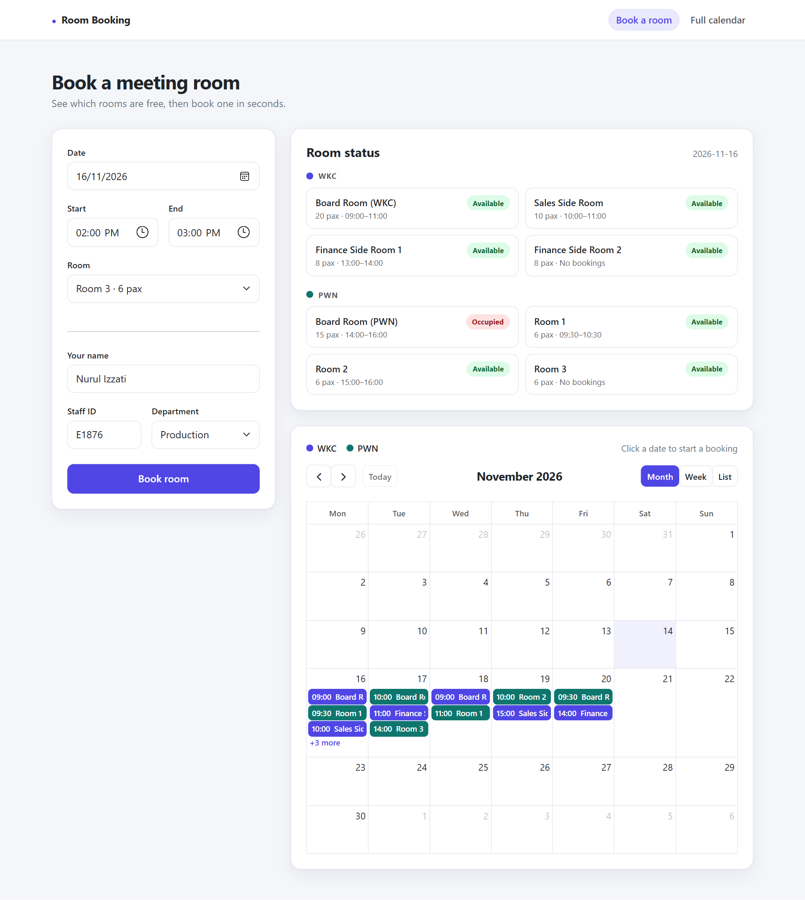
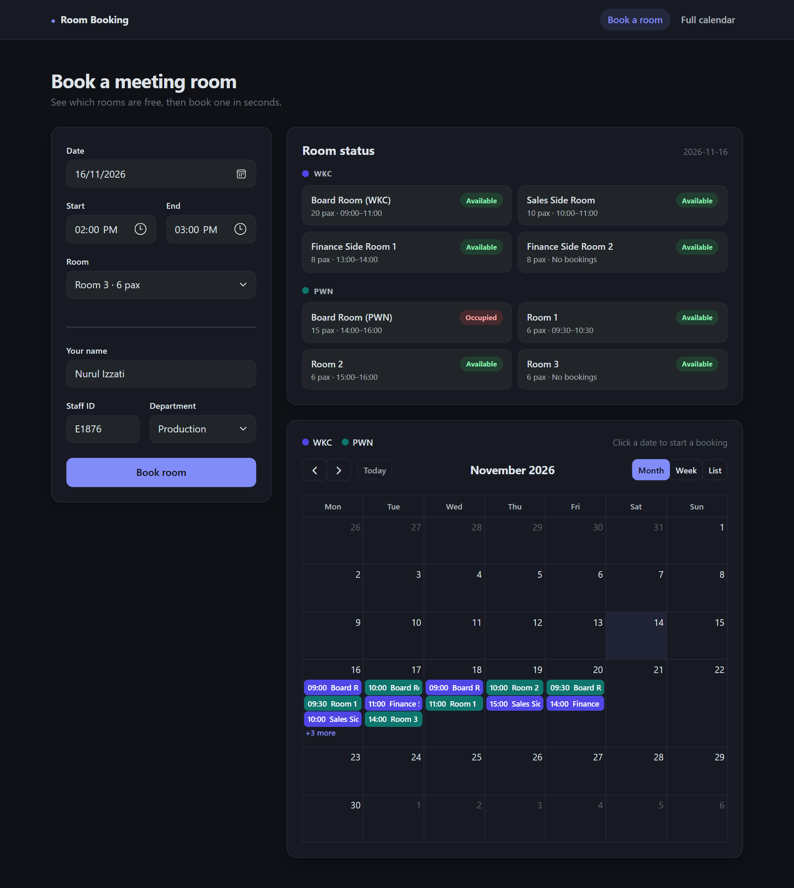
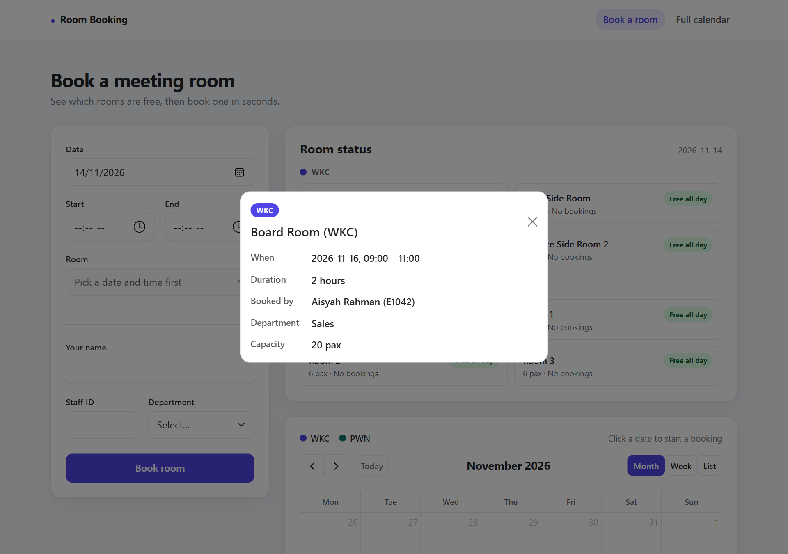
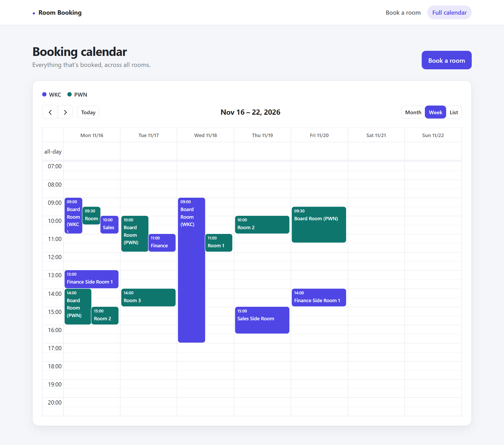
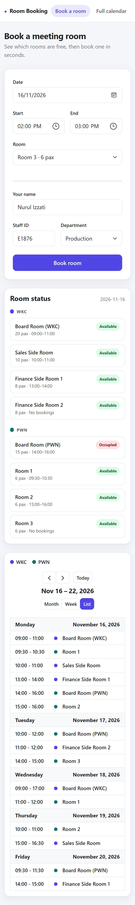

# Meeting Room Booking System

A simple, modern meeting room booking app. Pick a date and time, see which rooms are free, and book one in seconds. No database: bookings are saved as plain text files.



## Features

- **Live room status**: every room at a glance for the chosen date, with *Available* / *Occupied* / *Booked today* badges and the booked time ranges.
- **Only free rooms are offered**: the room list updates as soon as you pick a date and time.
- **Double-booking protection**: availability is re-checked under a file lock when you book, so two people can't take the same slot.
- **Calendar**: month, week and list views, colour-coded by location. Click a booking for its details, or click a day to start a new booking.
- **Light and dark themes**: follows your device setting.
- **Works on phones**: the layout stacks and the calendar switches to a list.

| Dark theme | Booking details |
| --- | --- |
|  |  |

| Full calendar (week view) | On a phone |
| --- | --- |
|  |  |

## Run it locally

You need PHP 8 or newer. No database and no build step.

```bash
php -S localhost:8000
```

Then open <http://localhost:8000>. The `data/` folder is created automatically on the first booking. On a web server (Apache or Nginx with PHP), upload the files and make sure `data/` is writable.

## Configure

Edit [config.php](config.php):

- `ROOMS_FEATURES`: your rooms, their capacity and location.
- `LOCATION_COLORS`: the calendar colour for each location.
- `DEPARTMENTS`: the department drop-down.

## How it works

| File | Purpose |
| --- | --- |
| `index.php` | Booking page (form, room status, calendar) |
| `calendar.php` | Full-width calendar |
| `book.php` | Validates and saves a booking (JSON) |
| `get_available_rooms.php` | Room options that are free for a slot |
| `room_status.php` | Per-room status for a date (JSON) |
| `events.php` | Calendar events (JSON) |
| `Rooms.class.php` | Reads and writes bookings, with locking |
| `assets/` | Stylesheet and script |
| `data/` | Bookings, one `YYYY-MM-DD.txt` file per day |

Each line in a data file is one booking: `room,start,end,name,department,staffId`.

Credit : Rie
